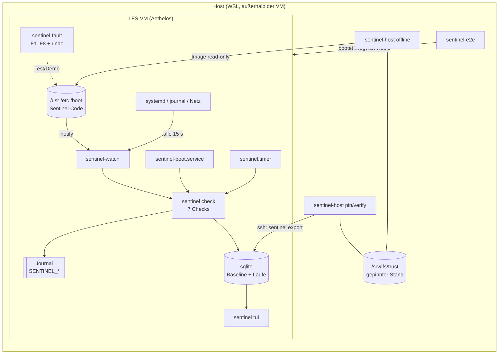

# Sentinel

**Integritäts- und Diagnose-Wächter für ein selbst gebautes Linux.** Sentinel läuft auf *Aethelos*, einem System, das
von Grund auf nach [Linux From Scratch 13.1 (systemd)](https://www.linuxfromscratch.org/lfs/view/13.1-systemd/) gebaut wurde:
Toolchain, Kernel 7.1.8, systemd 261, dazu BLFS (OpenSSH, curl, git, sudo). Es läuft als QEMU/KVM-VM in WSL2.
Sentinel ist komplett in dieser VM entstanden, nur mit der Python-3.14-Standardbibliothek und ohne Fremdpakete.

Was es kann:
- Es merkt, wenn sich Programme, Bibliotheken, Kernel-Module, `/etc` oder `/boot` ändern, über SHA-256, Rechte und Besitzer, und wenn neue SUID-Dateien oder UID-0-Konten auftauchen.
- Es überwacht Dienste, Netz, Journal, Ressourcen und den Boot.
- Es zeigt alles live in einem Terminal-Dashboard. Nach einer Manipulation ist die Kachel nach **etwa 4 s rot**.
- Es hat einen **Vertrauensanker außerhalb der VM**. Der fällt auch dann nicht herein, wenn ein Angreifer mit root-Rechten die Baseline fälscht.
- Es testet sich selbst mit **reproduzierbaren Fehler-Injektionen**, von Unit-Tests bis zum Ende-zu-Ende-Lauf in einer Wegwerf-VM.

## Architektur



| Check | prüft | Befund |
|---|---|---|
| `integrity` | SHA-256, Rechte, Besitzer: `/usr/bin`, `/usr/sbin`, `/usr/lib/*.so*`, `*.ko*`, `/etc`, `/boot`, Sentinels eigener Code; neue SUID-Dateien im ganzen System | CRIT / WARN |
| `accounts` | zusätzliche UID-0-Konten, leere Passwortfelder | CRIT |
| `services` | fehlgeschlagene Units, Pflicht-Dienste (sshd, networkd, resolved, journald), dazu die letzte systemd-Meldung zur Unit | WARN |
| `network` | Link, IPv4-Adresse (ioctl, kein iproute2 nötig), DNS mit Zeitlimit; HTTPS optional | WARN |
| `logs` | neue Journal-Meldungen `err` und schlimmer seit dem letzten Lauf (Cursor), je Absender zusammengefasst | WARN |
| `resources` | Platte und Inodes ≥ 90 %, RAM < 10 % frei, Load > 2 × CPUs | WARN |
| `boot` | Kernel-taint, Boot-Dauer | WARN |

Exit-Codes: `0` ok, `10` Warnung, `11` kritisch, `2` Sentinel konnte nicht prüfen. Das ist **fail-closed**: Was Sentinel nicht prüfen kann, meldet es nie als grün.

## Bedienung

In der VM, als root:
```
sentinel baseline            # Soll-Zustand aufnehmen
sentinel check [--json]      # alle Checks (Live-Checks nur für --root /), --checks a,b für eine Auswahl
sentinel report [--json]     # letzter Lauf
sentinel tui                 # Dashboard (q beendet), --once als Text
sentinel export              # Baseline als JSON für den Host
sentinel-fault list|inject|undo|status F1..F8
sentinel-selftest [--json]   # alle Fehler injizieren, erkennen, zurücksetzen
sentinel-demo                # Demo-Ablauf mit Stoppuhr (sentinel-watch muss laufen)
```
Installation: `sh systemd/install.sh` installiert die Wrapper sowie die Units `sentinel-boot`, `sentinel.timer` und
`sentinel-watch`. Danach `sentinel baseline && systemctl start sentinel-watch`. Jeder Check schreibt eine Zusammenfassung ins
Journal: `journalctl -t sentinel` oder `journalctl SENTINEL_EXIT=11`.

Auf dem Host (WSL, als root): `sentinel-host pin | verify | offline`, `sentinel-e2e`. Installiert wird das aus einem
Git-Bundle mit `sh host/install-host.sh <bundle>`.

## Fehler-Katalog und Belege

| ID | Fehler | erkannt durch |
|---|---|---|
| F1 | Bytes an `/usr/bin/ls` anhängen | integrity, CRIT |
| F2 | neue SUID-Datei in `/usr/local/bin` | integrity, CRIT |
| F3 | zusätzliches UID-0-Konto | accounts, CRIT |
| F4 | `sshd` stoppen | services, WARN, mit „Stopped OpenSSH Daemon.“ |
| F5 | Link-DNS auf `127.0.0.1` | network, WARN |
| F6 | Platte über 93 % (fallocate) | resources, WARN |
| F7 | `logger -p err` | logs, WARN |
| F8 | Bytes an `/boot/vmlinuz-*` anhängen | integrity, CRIT |
| F9 | **root-Angreifer:** `ls` ändern **und** Baseline neu schreiben | VM: **blind** (bewusst getestet) · Host `verify`: CRIT · Host `offline`: CRIT |

Gemessen am 2026-11-13 in Wegwerf-VMs:
- **Unit-Tests:** 115/115, auf Fake-Dateisystemen und mit gefälschten `systemctl`/`journalctl`-Ausgaben.
- **`sentinel-e2e`:** **14/14**, mehrfach, in jeweils rund 2 Minuten.
- **Dashboard rot nach Manipulation:** 4,0–4,1 s. Das Ziel war ≤ 15 s.
- **Baseline:** rund 2940 Einträge in etwa 4–8 s, `check` in etwa 2,5 s.

Zwei Dinge hat Sentinel auf dem echten System gefunden:
- **Einen echten Boot-Fehler.** `systemd-vconsole-setup` scheiterte in 4 von 7 Boots, weil er sich mit der Autologin-getty um tty1 stritt. Behoben im System per Drop-in, danach 0 von 8.
- **Einen Testfehler im eigenen Katalog.** „resolved stoppen“ ist unter systemd 261 gar kein DNS-Ausfall, weil die Socket-Aktivierung den Dienst sofort neu startet. F5 wurde deshalb umgebaut.

## Vertrauensmodell (ehrlich)
- Sentinel in der VM erkennt **unerwartete Änderungen**. Es schützt nicht vor einem Angreifer, der root ist: Der kann die Baseline neu schreiben (F9).
- Dagegen hilft der Host. `pin` speichert den Stand außerhalb der VM und rechnet den Digest selbst nach. `verify` vergleicht den aktuellen Stand dagegen. `offline` prüft die ausgeschaltete Platte read-only mit dem **Code des Hosts**, und der hängt nicht von der VM ab.
- Grenze: Der Host-Code kommt einmal aus einem Bundle aus der VM („trust on first use“). Ein Angreifer mit Zugriff auf den Host ist nicht abgedeckt.
- Nächste Stufe: den Kernel mit **fs-verity/IMA** bauen. Beides ist im aktuellen Kernel aus, geprüft in `/boot/config-7.1.8`.
- Vergleichbar mit AIDE, Tripwire und IMA. Das Eigene an Sentinel: selbst gebautes System, Boot-Selbstcheck, Live-Dashboard, externer Anker und ein reproduzierbares Fehler-Testlabor.

## Tests
```
python3 -m unittest discover -s tests -t .     # Unit (VM: Python 3.14, Host: 3.13)
sudo sentinel-selftest                          # Integration auf dem echten System: nur in einer Wegwerf-VM
sentinel-e2e                                    # Host: Wegwerf-Kopie der Platte, Demo + F1–F9, Tabelle
```

## Aufbau des Repos
`sentinel/` Paket (Checks, Store, CLI, TUI, Watch, inotify, Host-Seite) · `tests/` Unit-Tests · `systemd/` Units und Installer ·
`host/` Host-Werkzeuge · `bin/` Wrapper · `tools/` TUI-Rauchtest und Demo-Recorder.

Lizenz: MIT, siehe [LICENSE](LICENSE).
